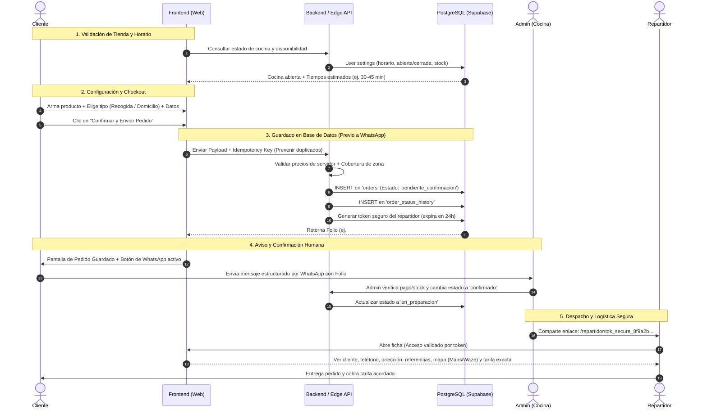

# Propuesta de Arquitectura Técnica y UX/UI Revisada (Presupuesto $0 MXN)
## BAKU-BAKU SUSHI & FIRE

Esta propuesta integra todas las correcciones funcionales, de seguridad y de negocio solicitadas, anteponiendo la **restricción obligatoria de $0 MXN** sobre cualquier decisión tecnológica. No se ha escrito código, no se han instalado paquetes y los activos oficiales (`logo.jpg`) se mantienen intactos.

---

## 1. Clasificación del Estado del Proyecto

```
┌────────────────────────────────────────────────────────────────────────┐
│                        ESTADO DE LAS DECISIONES                        │
├──────────────────────────┬──────────────────────────┬──────────────────┤
│     CONFIRMADO           │       PROPUESTA          │    PENDIENTE     │
│ (Reglas inmutables)      │ (Sujeto a validación)    │ (Requiere datos) │
├──────────────────────────┼──────────────────────────┼──────────────────┤
│ • Presupuesto $0 MXN     │ • Next.js + Cloudflare / │ • Lista oficial  │
│ • No tarjetas de crédito │   Vite + Supabase Free   │   de colonias y  │
│ • Logo oficial intacto   │ • 2 decoraciones +       │   tarifas.       │
│ • PostgreSQL objetivo    │   1 salsa incluida       │ • Límites de "la │
│ • Bola cortada en 4      │ • Leaflet + Nominatim    │   pista".        │
│ • No pasarelas de pago   │   optimizado con debounce│ • Precio final   │
│ • DB antes de WhatsApp   │ • Token hash repartidor  │   de la bola     │
│ • Dirección privada      │ • Control apertura por   │   ($95 beta prov)│
│ • Ficha tokenizada       │   cron/horario + manual  │ • Costo de extras│
└──────────────────────────┴──────────────────────────┴──────────────────┘
```

### A. Confirmado
1. **Presupuesto $0 MXN estricto:** Prohibido el uso de servicios que soliciten tarjeta bancaria, créditos de prueba temporales disfrazados de gratuitos o servicios con riesgo de cobro sorpresivo.
2. **Identidad intacta:** El logo (`logo.jpg`) y la mascota no se tocan, deforman ni alteran.
3. **Producto:** Bolas de arroz rellenas de surimi y queso crema, empanizadas en panko y servidas en cuatro cuartos con salsa aparte. No son makis, nigiris ni croquetas.
4. **PostgreSQL como motor central:** Modelo relacional formal desde el inicio; SQLite queda relegado estrictamente a pruebas de integración locales offline.
5. **Persistencia previa a notificación:** El pedido se guarda, valida y calcula en el servidor **antes** de habilitar el botón de WhatsApp. Abrir WhatsApp nunca equivale a confirmar el pedido.
6. **Privacidad de recogida:** La dirección del taller en Temixco jamás se publica en la web abierta; se entrega al cliente tras la confirmación formal del pedido.
7. **Seguridad del repartidor:** Enlaces mediante tokens únicos, criptográficamente seguros, revocables y acotados exclusivamente al pedido asignado.

### B. Propuesta Técnica y Comercial
1. **Regla de personalización:** Hasta 2 decoraciones y 1 salsa incluida en el precio base. Salsas o ingredientes adicionales se desglosan con costo extra.
2. **Stack de costo cero:** Supabase Free (PostgreSQL + RLS + Storage) + Cloudflare Pages (hosting estático + Workers) o Vercel Free, evaluando compatibilidad y límites comerciales.
3. **Cartografía responsable:** Leaflet + OpenStreetMap con geolocalización nativa del navegador (HTML5 Geolocation) para costo $0 y cumplimiento estricto de los Términos de Servicio de la Fundación OpenStreetMap.

### C. Pendientes Críticos (Requieren Información del Propietario)
1. **Catálogo de Zonas y Tarifas de Temixco:** Se requiere la tabla con los nombres exactos de colonias y el costo de envío asociado. Mientras no se disponga de ella, la plataforma **no inventará tarifas** y el checkout sólo permitirá "Recogida local" o mostrará "Zona por verificar con repartidor".
2. **Límite de "La Pista":** Definición territorial clara de hasta dónde llega el repartidor para bloquear pedidos fuera de cobertura.
3. **Precios y Costos de Extras:** Confirmar si el precio beta provisional se mantiene en **$95 MXN** y definir el costo unitario de porciones extra (ej. salsa extra, aguacate extra).

---

## 2. Auditoría de Servicios: Viabilidad $0 MXN y Condiciones de Uso

A continuación se analizan los límites, políticas y riesgos de cada proveedor bajo la premisa de **cero tarjetas y cero costos obligatorios**:

| Proveedor | Servicio / Capacidad | Límites del Plan Gratuito | ¿Pide Tarjeta? | Términos de Uso Comercial | Riesgos e Imprevistos | Mitigación en Arquitectura |
| :--- | :--- | :--- | :--- | :--- | :--- | :--- |
| **Supabase** | PostgreSQL + Auth + Storage | • 500 MB de base de datos.<br>• 1 GB almacenamiento de archivos.<br>• 2 GB ancho de banda/mes.<br>• 50,000 usuarios activos/mes. | **NO** obligatoria en Free Tier. | **Permitido.** Acepta proyectos comerciales en fase inicial. | **Pausa por inactividad:** Proyectos sin tráfico en 7 días entran en pausa. | El volumen de texto de pedidos ocupa `< 50 KB` por cada 100 órdenes. Se implementa un ping HTTP diario para evitar la pausa. |
| **Cloudflare Pages / Workers** | Hosting frontend y funciones Serverless | • Sitios ilimitados y ancho de banda ilimitado.<br>• 100,000 peticiones diarias en Workers.<br>• Despliegues automáticos desde GitHub. | **NO** obligatoria. | **Permitido.** Ideal para producción comercial sin sorpresas. | Compatible al 100% con SPAs (Vite/React) o Next.js exportado; Server Actions completas de Node requieren configuración Edge. | Si se usa Next.js, se opta por exportación estática con APIs en Cloudflare Pages Functions o Supabase Edge Functions. |
| **OpenStreetMap & Nominatim** | Mapas interactivos y geocodificación | • Visualización de mapa vía Leaflet.<br>• Búsqueda de calles y colonias. | **NO** (Servicio comunitario libre). | **Uso regulado:** Prohíbe rastreo masivo, exige `User-Agent` único y máximo **1 petición/segundo**. | Si se abusa de peticiones de geocodificación inversa, OSM bloquea la IP del cliente o del servidor. | Se prioriza el pin manual y la API nativa de geolocalización del celular (GPS del navegador). Reverse geocoding restringido y con debounce de 1.5s. |
| **GitHub** | Repositorio de código y CI/CD | • Repositorios públicos/privados ilimitados.<br>• 2,000 minutos/mes de Actions. | **NO**. | **Permitido.** | Agotar minutos de build (poco probable para este tamaño). | Compilaciones locales antes de push si fuera necesario. |
| **WhatsApp Direct** | Comunicación y confirmación | • Enlaces web `https://wa.me/`. | **NO**. | **Permitido.** Es enlace directo al cliente nativo. | Dependencia de que el cliente no altere el mensaje al enviarlo. | El pedido ya está guardado en base de datos; el mensaje es sólo notificación de aviso. |

---

## 3. Condiciones de Uso de Cartografía (OpenStreetMap / Leaflet)

Para respetar los Términos de Servicio de OpenStreetMap (Tile Usage Policy) y la política de uso de Nominatim sin caer en bloqueos ni incurrir en costos:

```
[ Cliente en Checkout ]
         │
         ├──> Opción A: "Usar mi ubicación GPS" ──> API navigator.geolocation (Nativa del móvil: $0, 0 peticiones a OSM)
         │                                          └─> Fija Lat/Lng exactas directamente en el mapa.
         │
         └──> Opción B: "Mover Pin en Mapa" ───────> Leaflet interactivo con tiles de OpenStreetMap (cacheo en cliente)
                                                    └─> Reverse Geocoding se dispara ÚNICAMENTE al soltar el pin (evento 'dragend'),
                                                        con User-Agent personalizado y rate-limiting estricto.
```

1. **Sin APIs de pago:** Se prescinde absolutamente de Google Maps Platform o Mapbox para evitar llaves de pago o ingresos de tarjetas.
2. **Carga responsable de capas:** Se utilizan los servidores de teselas oficiales de OSM bajo encabezado HTTP representativo (`User-Agent: BakuBakuWeb/1.0 (contacto@bakubaku.com)`).
3. **Mapeo offline/fallback:** Si la geocodificación automática fallara o no tuviera conexión, el sistema almacena la latitud/longitud directas del pin del mapa junto con la dirección y referencias escritas a mano por el usuario.

---

## 4. Flujo Operativo y de Seguridad del Pedido



### Reglas Clave del Flujo
1. **Prevención de Duplicados (Idempotencia):** Al presionar "Confirmar", el frontend genera una clave única basada en la sesión y el carrito (`idempotency_key`), bloqueando clics repetidos. Si la petición ya existe en tránsito, no se genera una segunda orden.
2. **Disponibilidad y Horarios:** La tienda cuenta con un interruptor manual (`kitchen_status: open | closed | busy`) y una tabla de horarios programados. Si la cocina está cerrada, el configurador permite armar el producto pero el checkout muestra claramente el aviso de fuera de horario.
3. **El Estado 'Pendiente de Confirmación':** Todo pedido nuevo entra a la base de datos con estatus `pendiente_confirmacion`. Si el usuario cierra WhatsApp o nunca envía el mensaje, el pedido queda registrado como no confirmado para auditoría interna, evitando que la cocina prepare comida no pactada.

---

## 5. Modelo de Datos Exhaustivo en PostgreSQL

Este esquema cumple con la inmutabilidad de precios mediante **snapshots profundos**, historial de cambios de estado, almacenamiento desglosado de direcciones y control de acceso del repartidor mediante tokens criptográficos revocables.

```sql
-- 1. CONFIGURACIÓN DEL SISTEMA Y OPERACIÓN
CREATE TABLE system_settings (
    key VARCHAR(50) PRIMARY KEY,
    value TEXT NOT NULL,
    updated_at TIMESTAMP WITH TIME ZONE DEFAULT CURRENT_TIMESTAMP
);
-- Ejemplos de llaves: 'kitchen_open' (true/false), 'estimated_wait_minutes' ('35-45'), 'opening_hours_json'

-- 2. CATÁLOGO Y PRODUCTO BASE
CREATE TABLE products (
    id UUID PRIMARY KEY DEFAULT gen_random_uuid(),
    slug VARCHAR(50) UNIQUE NOT NULL,
    name VARCHAR(100) NOT NULL,
    description TEXT NOT NULL,
    base_price DECIMAL(10,2) NOT NULL,
    is_active BOOLEAN DEFAULT TRUE,
    image_url TEXT NOT NULL,
    created_at TIMESTAMP WITH TIME ZONE DEFAULT CURRENT_TIMESTAMP
);

-- 3. OPCIONES DE PERSONALIZACIÓN (Decoraciones y Salsas)
CREATE TABLE customization_options (
    id UUID PRIMARY KEY DEFAULT gen_random_uuid(),
    category VARCHAR(20) NOT NULL CHECK (category IN ('decoracion', 'salsa')),
    name VARCHAR(80) NOT NULL,
    extra_price DECIMAL(10,2) DEFAULT 0.00,
    layer_image_url TEXT NOT NULL,
    is_available BOOLEAN DEFAULT TRUE,
    display_order INT DEFAULT 0
);

-- 4. ZONAS DE REPARTO Y TARIFAS
CREATE TABLE delivery_zones (
    id UUID PRIMARY KEY DEFAULT gen_random_uuid(),
    neighborhood_name VARCHAR(120) NOT NULL,
    municipality VARCHAR(80) DEFAULT 'Temixco',
    delivery_fee DECIMAL(10,2) NOT NULL,
    is_active BOOLEAN DEFAULT TRUE,
    notes TEXT,
    created_at TIMESTAMP WITH TIME ZONE DEFAULT CURRENT_TIMESTAMP
);

-- 5. PEDIDOS (Cabecera Principal)
CREATE TABLE orders (
    id UUID PRIMARY KEY DEFAULT gen_random_uuid(),
    order_number VARCHAR(20) UNIQUE NOT NULL, -- Ej: BK-2026-001
    idempotency_key VARCHAR(64) UNIQUE NOT NULL,
    order_type VARCHAR(15) NOT NULL CHECK (order_type IN ('recogida', 'entrega')),
    status VARCHAR(30) NOT NULL DEFAULT 'pendiente_confirmacion' CHECK (
        status IN ('pendiente_confirmacion', 'confirmado', 'en_preparacion', 'listo_para_entrega', 'en_camino', 'entregado', 'cancelado')
    ),
    customer_name VARCHAR(120) NOT NULL,
    customer_phone VARCHAR(15) NOT NULL,
    
    -- Dirección desglosada
    street_and_number TEXT,
    interior_number VARCHAR(20),
    neighborhood VARCHAR(120),
    references_text TEXT,
    latitude DECIMAL(10,8),
    longitude DECIMAL(11,8),
    
    -- Tarifa y zona capturada
    delivery_zone_id UUID REFERENCES delivery_zones(id),
    delivery_fee_snapshot DECIMAL(10,2) DEFAULT 0.00,
    
    -- Totales inmutables
    items_subtotal DECIMAL(10,2) NOT NULL,
    total_amount DECIMAL(10,2) NOT NULL,
    estimated_time_text VARCHAR(50),
    
    -- Ficha segura del repartidor
    rider_access_token VARCHAR(64) UNIQUE,
    rider_token_expires_at TIMESTAMP WITH TIME ZONE,
    rider_token_revoked BOOLEAN DEFAULT FALSE,
    
    notes TEXT,
    created_at TIMESTAMP WITH TIME ZONE DEFAULT CURRENT_TIMESTAMP
);

-- 6. ITEMS DEL PEDIDO (Snapshot de Producto)
CREATE TABLE order_items (
    id UUID PRIMARY KEY DEFAULT gen_random_uuid(),
    order_id UUID NOT NULL REFERENCES orders(id) ON DELETE CASCADE,
    product_id UUID REFERENCES products(id),
    product_name_snapshot VARCHAR(100) NOT NULL,
    unit_price_snapshot DECIMAL(10,2) NOT NULL,
    quantity INT NOT NULL CHECK (quantity > 0),
    subtotal DECIMAL(10,2) NOT NULL
);

-- 7. DETALLE DE PERSONALIZACIÓN POR ITEM (Snapshot de Opciones)
CREATE TABLE order_item_customizations (
    id UUID PRIMARY KEY DEFAULT gen_random_uuid(),
    order_item_id UUID NOT NULL REFERENCES order_items(id) ON DELETE CASCADE,
    option_id UUID REFERENCES customization_options(id),
    option_name_snapshot VARCHAR(80) NOT NULL,
    option_category_snapshot VARCHAR(20) NOT NULL,
    extra_price_snapshot DECIMAL(10,2) DEFAULT 0.00
);

-- 8. AUDITORÍA E HISTORIAL DE ESTADOS
CREATE TABLE order_status_history (
    id UUID PRIMARY KEY DEFAULT gen_random_uuid(),
    order_id UUID NOT NULL REFERENCES orders(id) ON DELETE CASCADE,
    previous_status VARCHAR(30),
    new_status VARCHAR(30) NOT NULL,
    changed_by VARCHAR(50) DEFAULT 'sistema',
    notes TEXT,
    created_at TIMESTAMP WITH TIME ZONE DEFAULT CURRENT_TIMESTAMP
);
```

---

## 6. Seguridad de la Ficha del Repartidor

Para garantizar que un repartidor (o un tercero) no tenga acceso a la lista global de clientes ni a pedidos ajenos, se aplica la siguiente política criptográfica:

```
Generación al guardar el pedido:
  Token = crypto.randomBytes(32).toString('hex')  // 64 caracteres de alta entropía
  Vigencia = NOW() + 24 horas
  Ruta generada = /repartidor/BK-2026-001?token=f8a29e4d1b...

Mecanismos de Protección:
  1. Token Scoped: El token sólo permite consultar un único pedido mediante consulta parametrizada.
  2. Caducidad Automática: Tras 24 horas, la vista expira y muestra "Ficha expirada".
  3. Revocación Manual Inmediata: Si el pedido se cancela o se reasigna, el campo 'rider_token_revoked'
     se marca como TRUE desde el panel admin, invalidando el enlace al instante.
  4. Sin datos sensibles ajenos: La vista no expone métricas del negocio ni información de otros clientes.
```

---

## 7. Wireframes y Experiencia de Usuario (Mobile-First)

### A. Vista del Cliente: Checkout con Control de Estado
```
┌──────────────────────────────────────────────┐
│  BAKU-BAKU SUSHI & FIRE          [ 🛍️ (1) ] │
├──────────────────────────────────────────────┤
│ 🟢 COCINA ABIERTA                            │
│ Tiempo estimado de entrega: 35 - 45 min      │
├──────────────────────────────────────────────┤
│ Tu Pedido:                                   │
│ 1x Bola de Fuego (Surimi + Queso Crema) $95  │
│    • Decoraciones: Cebollín, Ajonjolí        │
│    • Salsa: Teriyaki                         │
├──────────────────────────────────────────────┤
│ Modalidad:                                   │
│ [ 🛍️ Recoger en Taller ]  [ 🛵 A Domicilio ] │
├──────────────────────────────────────────────┤
│ Datos de Entrega:                            │
│ Nombre: [ Carlos Mendoza                   ] │
│ Teléfono: [ 777 123 4567                   ] │
│ Calle y No: [ Av. Reforma #12              ] │
│ Colonia: [ Seleccionar colonia...        ▼ ] │
│ ⚠️ Si tu colonia no aparece, contáctanos.    │
│ Referencias: [ Portón café, timbre blanco  ] │
├──────────────────────────────────────────────┤
│ Ubicación exacta (Pin en el mapa):           │
│ [ 🎯 Usar mi ubicación actual ]              │
│ ┌──────────────────────────────────────────┐ │
│ │  [+]               [📍 Pin aquí]         │ │
│ │  [-]                                     │ │
│ └──────────────────────────────────────────┘ │
│ Coordenadas fijadas: 18.8542, -99.2314       │
├──────────────────────────────────────────────┤
│ Subtotal: $95.00                             │
│ Costo de Envío: $25.00                       │
│ TOTAL A PAGAR: $120.00                       │
├──────────────────────────────────────────────┤
│ [   CONFIRMAR Y ENVIAR POR WHATSAPP   ]     │
│ 🔒 Tu pedido se registrará con folio seguro  │
└──────────────────────────────────────────────┘
```

### B. Vista Exclusiva del Repartidor (`/repartidor/[orderId]?token=...`)
```
┌──────────────────────────────────────────────┐
│  FICHA DE ENTREGA #BK-2026-001               │
│  Estado: Listo para Entrega                  │
├──────────────────────────────────────────────┤
│ CLIENTE: Carlos Mendoza                      │
│ [ 📞 LLAMAR AL CLIENTE (777 123 4567) ]      │
├──────────────────────────────────────────────┤
│ DIRECCIÓN:                                   │
│ Av. Reforma #12, Col. Centro, Temixco        │
│ REF: Portón café, timbre blanco              │
├──────────────────────────────────────────────┤
│ NAVEGACIÓN GPS:                              │
│ [ 📍 ABRIR EN GOOGLE MAPS ] [ 🚗 EN WAZE ]   │
├──────────────────────────────────────────────┤
│ MONTO A COBRAR EN DESTINO:                   │
│ ┌──────────────────────────────────────────┐ │
│ │  ENVÍO: $25.00 MXN                       │ │
│ │  TOTAL PEDIDO + ENVÍO: $120.00 MXN       │ │
│ └──────────────────────────────────────────┘ │
│ (Efectivo al entregar el domo cerrado)       │
└──────────────────────────────────────────────┘
```

---

## 8. Fases de Desarrollo Planificadas

Una vez que otorgues tu aprobación, el desarrollo se ejecutará en estas fases ordenadas:

1. **Fase 1: Configuración de Base de Datos y Repositorio ($0 MXN)**
   * Creación del proyecto en Supabase Free (PostgreSQL).
   * Ejecución del script DDL con tablas, llaves foráneas, índices e historial de estados.
   * Estructura inicial del proyecto frontend/backend conectada al repositorio sin incurrir en costos.

2. **Fase 2: Motor Visual "ARMA TU BAKU"**
   * Incorporación del activo oficial `logo.jpg` en la interfaz.
   * Montaje de las capas visuales transparentes con CSS Stack responsivo para la bola en cuatro cuartos.
   * Regla de selección: máximo dos decoraciones y una salsa.

3. **Fase 3: Módulo de Checkout, Horarios y Mapa OpenStreetMap**
   * Integración de Leaflet sin llaves de pago con detección GPS nativa.
   * Validación de apertura/cierre de cocina y tiempos de espera estimados.
   * Prevención de pedidos duplicados con `idempotency_key`.

4. **Fase 4: Persistencia de Órdenes y Enlace de WhatsApp**
   * Registro del pedido y snapshot de precios en PostgreSQL antes de redireccionar a WhatsApp.
   * Generación del mensaje estructurado con folio único.

5. **Fase 5: Panel de Administración, Ficha Tokenizada y Exportador 9:16**
   * Tablero de control para cambiar estados del pedido y consultar auditoría.
   * Generación de enlaces con tokens seguros para el repartidor.
   * Lienzo HTML5 Canvas para exportar el menú en formato 9:16 para Instagram Stories.

6. **Fase 6: Verificación de Seguridad y Documentación**
   * Pruebas de navegación en navegadores móviles (Chrome/Safari).
   * Verificación de la no exposición de credenciales privadas.
   * Documentación para el mantenimiento y respaldo de la base de datos.

---

## 9. Estado de Espera

No he generado código, no he instalado librerías ni he modificado archivos del repositorio. 

Esta propuesta integra todos tus requerimientos de seguridad, control de estados, base de datos PostgreSQL, viabilidad financiera de $0 MXN y respeto total a la identidad de marca.
